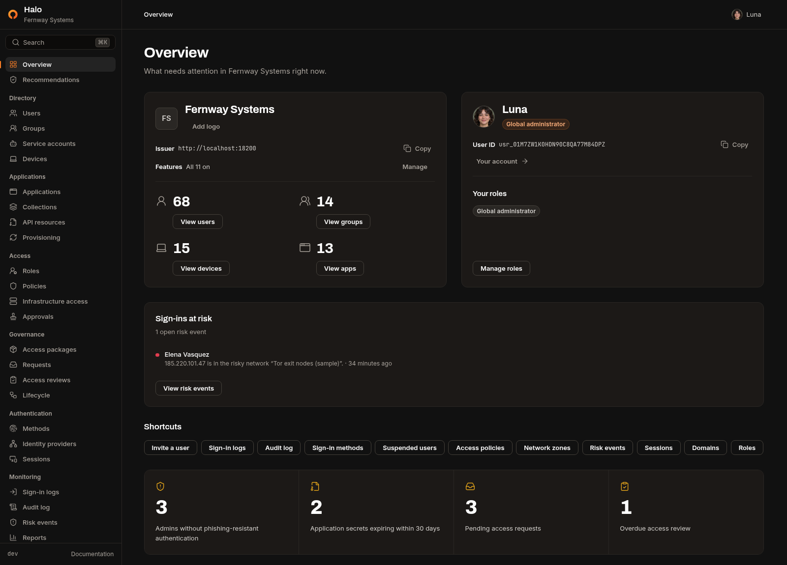
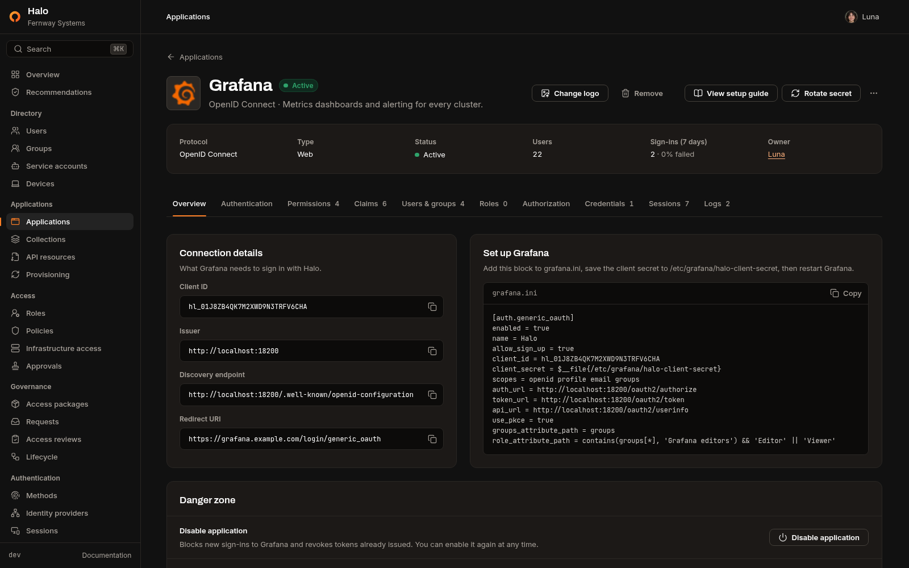
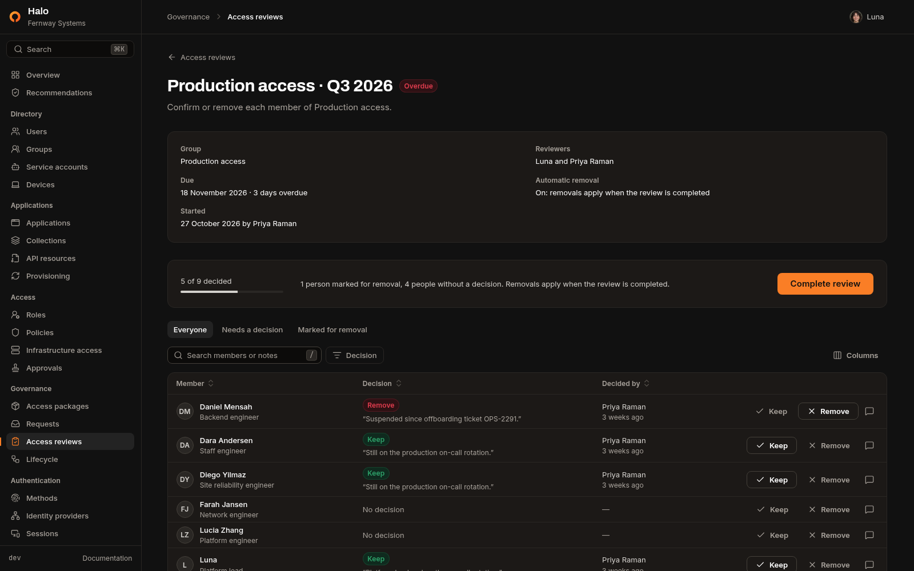
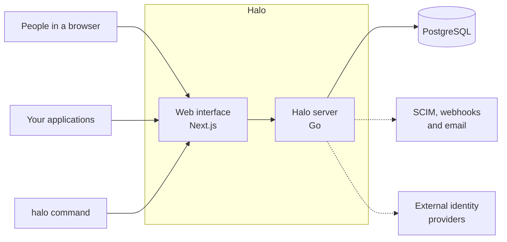

<h1></h1>

[](https://github.com/ScalaStudios/Halo/actions/workflows/ci.yml)
[](CHANGELOG.md)
[](LICENSE)

**Halo is an open-source identity and access management (IAM) platform that you host yourself.** It is where your organization decides who can sign in to which applications, how they prove who they are, and how long their access lasts.

In identity terms, Halo is an identity provider (IdP) for single sign-on (SSO) over OpenID Connect (OIDC) and SAML 2.0, with passwordless sign-in through passkeys, SCIM 2.0 provisioning, conditional access policies and identity governance. It comes with its own directory, admin console and account portal: it is not an authentication library or a proxy in front of your applications.

[Website](https://halo.scala.gg) · [Quick start](#quick-start) · [Documentation](https://halo.scala.gg/docs) · [Integrations](#connect-your-first-application) · [Security](SECURITY.md)

> [!NOTE]
> Halo is pre-release. The current release is 0.1.1, which the install script installs, and the API and configuration may change before 1.0. [CHANGELOG.md](CHANGELOG.md) lists what is included.



## Why Halo

Halo works in the same space as hosted services such as Microsoft Entra ID, Okta and Auth0, and open-source projects such as Keycloak, authentik and ZITADEL. It is built around a few choices:

- **No passwords by default.** People sign in with passkeys and security keys, which are phishing-resistant. Authenticator apps, recovery codes and emailed sign-in links are fallbacks that you can turn off. Passwords stay off until you turn them on, for example for the groups you are moving from another identity provider.
- **Access that ends.** Access packages with approvers and time limits, access reviews, and joiner, mover, leaver, date and inactivity rules are part of the core product.
- **Policies you can test before they apply.** Report-only mode shows what a policy would have done to the last 24 hours of sign-ins, and the simulator shows how your policies would treat a given sign-in.
- **Small to run.** A Go server, a Next.js web interface and PostgreSQL. No Redis, no message queue and no license key.
- **Open source.** Every feature is in this repository, licensed under Apache-2.0, and users, groups, applications and policies export as JSON.

## Features

| Area | What Halo includes |
| --- | --- |
| **Sign-in** | Passkeys and security keys (WebAuthn), authenticator apps (TOTP), single-use recovery codes, and magic links or one-time codes by email. Sign-in through Google, Microsoft Entra ID, GitHub or any OpenID Connect provider, with account linking and accounts created on first sign-in. |
| **Single sign-on** | An OpenID Connect provider and OAuth 2.0 authorization server for web, single-page, native and machine-to-machine applications. A SAML 2.0 identity provider with service provider metadata import and IdP-initiated sign-in. Forward auth for Traefik, nginx and Caddy in front of applications that support neither, and a read-only LDAP directory for applications that only speak LDAP. |
| **Directory** | People with profiles and managers, assigned groups with owners and self-service joining, rule-based groups such as `user.department == "Engineering"`, service accounts, devices, and six administrative roles. |
| **Provisioning** | A SCIM 2.0 server, tested with the request formats of Okta and Microsoft Entra ID, so either of them or an HR system can provision people into Halo; LDAP directory sync that reads people and groups from Active Directory or OpenLDAP on a schedule and suspends people who leave; and outbound SCIM that creates, updates and deactivates accounts in your applications and keeps the groups you choose in step. |
| **Access policies** | Conditional access by person, group, application, network zone, device trust, device compliance from Microsoft Intune or a device agent, sign-in risk and sign-in method, with effects that allow, block, require a passkey or security key, or require accepting versioned terms of use, report-only mode and a simulator. |
| **Governance** | Access packages that people request, with approvers, justifications and time limits; access reviews that can remove access automatically when they complete; administrator roles that eligible people activate for a few hours with a reason; guest accounts with a sponsor and an end date; and joiner, mover and leaver rules, plus rules that run on a date such as a contract end date or after a number of days without signing in. |
| **Infrastructure access** | An SSH certificate authority that issues short-lived certificates to people in mapped groups, through `halo login` and `halo ssh-cert`, and a host certificate authority that signs registered servers' host keys with `halo ssh-host`, so people connect without the first-connection prompt; Linux accounts and sudo rules from Halo groups on your servers through `halo-hostd`; and a RADIUS server that signs people in to VPNs and network devices with their Halo password. |
| **Monitoring** | A sign-in log, an audit log of every administrative change, risk events for risky networks, repeated failures, new devices and new networks, signed webhooks for audit and sign-in events, and streaming of both to syslog or OpenTelemetry. |
| **Administration** | An admin console whose home page shows the directory, which features are on, your roles, open risk events and shortcuts, a self-service account portal with profile pictures, organization branding, sign-in methods you can switch off, optional areas you can switch off with their routes and background jobs (SAML, SCIM in either direction, SSH certificates, governance, webhooks, forward auth, RADIUS, the LDAP server and log streaming), email over SMTP with retries, JSON export with scheduled exports to an S3-compatible bucket, import of configuration from an export with a dry run, and rotation of client secrets, signing keys and `HALO_SECRET_KEY`. |
| **Developers** | A REST API described by an OpenAPI 3.1 document, API keys for service accounts, API resources with their own scopes and JWT access tokens, and setup guides with ready-made configuration for common applications. |

## Supported standards

| Standard | Status | How Halo uses it |
| --- | --- | --- |
| OpenID Connect Core 1.0 and Discovery 1.0 | Implemented | ID tokens signed with RS256, ES256 or EdDSA, userinfo, `prompt` and `max_age`, discovery at `/.well-known/openid-configuration`, RP-initiated logout, and back-channel logout with signed logout tokens |
| OAuth 2.0 (RFC 6749) | Implemented | Authorization code, refresh token and client credentials grants; refresh tokens rotate by default, and a used one is rejected |
| PKCE (RFC 7636) | Implemented | `S256`, required for single-page and native applications and for any application set to require it |
| Device Authorization Grant (RFC 8628) | Implemented | Used by `halo login` to sign people in on the command line |
| Token Introspection (RFC 7662) and Revocation (RFC 7009) | Implemented | Introspection for APIs that check opaque tokens, and revocation for applications that sign people out |
| Resource Indicators (RFC 8707) | Partial | The `resource` parameter selects an API resource on authorization, device, client credentials and token exchange requests, and its JWT access tokens carry it in `aud` |
| Token Exchange (RFC 8693) | Partial | Web and service applications with token exchange turned on trade a person's access token for one to an API they have scopes on, with the application in the `act` claim. Access tokens only, and no `actor_token` |
| Pushed Authorization Requests (RFC 9126) | Implemented | `/oauth2/par`, with a `request_uri` that works once within 60 seconds, and an option per application to require it |
| DPoP (RFC 9449) | Partial | Access and refresh tokens bound to the client's key with `cnf.jkt`, proofs checked at the token and userinfo endpoints, authorization codes bound with `dpop_jkt` or a proof at `/oauth2/par`, and an option per application to require it; no server-provided nonces |
| JWT client authentication (RFC 7523) | Implemented | `private_key_jwt` for web and service applications, with keys from a registered JWKS or `jwks_uri`, an algorithm allowlist without `none` or HMAC, and each `jti` refused a second time across instances |
| Authorization Server Issuer Identification (RFC 9207) | Implemented | `iss` in every authorization response, in the query, the fragment or the `form_post` form |
| FAPI 2.0 Security Profile | Partial | An option per application that requires private_key_jwt with PS256, ES256 or EdDSA assertions, pushed requests, PKCE with S256, DPoP, https redirect URIs, ES256 or EdDSA ID tokens and one-minute authorization codes. No mutual TLS, and refresh token rotation is left to the application's token policy |
| SAML 2.0 | Implemented | Web browser single sign-on as an identity provider: SP- and IdP-initiated, HTTP-Redirect and HTTP-POST bindings, signed assertions and metadata, and assertions encrypted with AES-256-GCM or AES-256-CBC per service provider. No single logout |
| Shared Signals Framework 1.0, CAEP and RISC | Partial | Security Event Tokens (RFC 8417) for ended sessions, credential and device compliance changes, suspensions, restores, deletions and email changes, pushed (RFC 8935) or polled (RFC 8936) by service applications a security administrator turns on. One stream per receiver, every person as subject, no subject management |
| SCIM 2.0 (RFC 7643 and RFC 7644) | Implemented | A server for users and groups with the full filter grammar and bulk operations, and a client that provisions users into applications |
| WebAuthn and FIDO2 | Implemented | Passkeys and security keys as discoverable credentials, for sign-in without a username |
| TOTP (RFC 6238) | Implemented | Six-digit codes from authenticator apps |
| RADIUS (RFC 2865 and RFC 2866) | Partial | PAP sign-in, Access-Challenge for authenticator codes, Message-Authenticator (RFC 3579) required on every Access-Request and sent first in every reply, and accounting stops in the sign-in log. No EAP, CHAP or RADIUS over TLS |
| LDAP (RFC 4511 and RFC 4513) | Partial | A client that syncs people and groups from a directory over LDAPS or StartTLS with the simple paged results control (RFC 2696), and a read-only server for applications that only speak LDAP: simple binds over LDAPS or StartTLS, search with and, or, not, equality, substring and presence filters and paged results, and no writes or SASL |

"Implemented" means the feature works in the current release. Halo has not been through OpenID Foundation conformance testing or any other certification.

## Quick start

### Install on a server

You need a Linux server with `curl` and `openssl`, a domain name such as `auth.example.com` that points at the server, and ports 80 and 443 open to the internet. Run the script as root and it installs Docker if the server doesn't have it.

```bash
curl -fsSL https://halo.scala.gg/install.sh | sh
```

The script asks for your domain and organization name, sets Halo up in `/opt/halo` (or `~/halo` when you are not root), generates a database password and `HALO_SECRET_KEY`, then downloads and starts PostgreSQL, Halo and Caddy, which obtains a TLS certificate for your domain. [Read the script](deploy/install.sh) before you run it if you prefer.

When it finishes, create the first administrator with the command it prints:

```bash
/opt/halo/halo.sh admin you@example.com "Your Name"
```

Open the link it prints and register a passkey. The console is at `https://auth.example.com/admin`. To install step by step instead, and for backups, upgrades and email, follow the [self-hosting guide](https://halo.scala.gg/docs/self-hosting).

### Run from source

To work on Halo or try it on your own computer, you need Go 1.27, [Bun](https://bun.sh) 1.3 or Node.js 22, and Docker.

```bash
git clone https://github.com/ScalaStudios/Halo.git && cd Halo
docker compose -f compose.dev.yml up -d
cp .env.example .env
```

Set `HALO_SECRET_KEY` in `.env` to the output of `openssl rand -base64 32`. Then create an administrator and start the server:

```bash
set -a && . ./.env && set +a
go run ./cmd/halo bootstrap --email you@example.com --name "Your Name"
go run ./cmd/halo serve
```

Start the web interface in a second terminal:

```bash
cd web && bun install && bun run dev
```

Open the setup link that `bootstrap` printed to register your passkey. Halo runs at http://localhost:3200. To explore a populated organization instead, `go run ./cmd/halo seed-demo` loads Fernway Systems, a demo company with 68 people; [Get started](https://halo.scala.gg/docs/getting-started#explore-with-demo-data) explains how to sign in to it.

## Connect your first application

1. In the console, open **Applications**, choose **Add application**, then **OpenID Connect** and **Web application**. Pick a template such as **Grafana**, or **Custom**.
2. Enter the application's redirect URI and choose **Create application**. Copy the client ID and the client secret; Halo shows the secret only once.
3. Open the application, go to **Users & groups**, and assign the groups whose members may sign in. Until a group is assigned, nobody can.
4. Configure the application with Halo's issuer, such as `https://auth.example.com`. Applications that support discovery read every endpoint from `https://auth.example.com/.well-known/openid-configuration`.

Each application page in the console shows its connection details and a setup guide with your values filled in. For Grafana, the guide is a block for `grafana.ini`:

```ini
[auth.generic_oauth]
enabled = true
name = Halo
allow_sign_up = true
client_id = hl_…
client_secret = $__file{/etc/grafana/halo-client-secret}
scopes = openid profile email groups
auth_url = https://auth.example.com/oauth2/authorize
token_url = https://auth.example.com/oauth2/token
api_url = https://auth.example.com/oauth2/userinfo
use_pkce = true
groups_attribute_path = groups
role_attribute_path = contains(groups[*], 'Grafana editors') && 'Editor' || 'Viewer'
```

Step-by-step guides cover [Grafana](https://halo.scala.gg/docs/integrations/grafana), [Forgejo](https://halo.scala.gg/docs/integrations/forgejo), [Nextcloud](https://halo.scala.gg/docs/integrations/nextcloud), [Kubernetes with kubelogin](https://halo.scala.gg/docs/integrations/kubernetes), [Proxmox VE](https://halo.scala.gg/docs/integrations/proxmox), [Outline](https://halo.scala.gg/docs/integrations/outline) and [Headscale](https://halo.scala.gg/docs/integrations/headscale) over OpenID Connect, and [AWS IAM Identity Center](https://halo.scala.gg/docs/integrations/aws-iam-identity-center) and [Slack](https://halo.scala.gg/docs/integrations/slack) over SAML. For anything else that supports OpenID Connect or SAML 2.0, start from the [generic OpenID Connect](https://halo.scala.gg/docs/integrations/generic-oidc) or [generic SAML](https://halo.scala.gg/docs/integrations/generic-saml) guide. [`examples/`](examples) has small Go applications that sign in with Halo over each protocol.

To automate Halo itself, create a service account with the user administrator role and an API key, and call the API. This invites a person and returns their setup link:

```bash
curl -X POST https://auth.example.com/api/v1/users \
  -H "Authorization: Bearer $HALO_API_KEY" \
  -H "Content-Type: application/json" \
  -d '{"email": "sam@example.com", "name": "Sam Lee", "department": "Engineering"}'
```

Every route is described in the OpenAPI document at `/api/v1/openapi.yaml`; the [API guide](https://halo.scala.gg/docs/api) covers authentication, roles and errors.

### Applications without OpenID Connect or SAML

Forward auth puts Halo's sign-in in front of applications that have their own login or none, such as admin consoles, file servers and internal tools. The reverse proxy in front of the application asks Halo before every request, and keeps carrying the traffic itself.

1. Choose **Add application**, then **Forward auth**, and enter the address people open the application at, such as `https://files.example.com`. Add more hosts on the **Authentication** tab.
2. Assign groups on **Users & groups**.
3. Copy the Traefik, nginx or Caddy configuration from the application's **Overview** tab. For Caddy:

```caddy
https://files.example.com {
	forward_auth https://auth.example.com {
		uri /forward-auth/app_…/verify
		header_up Host {upstream_hostport}
		copy_headers X-Halo-User X-Halo-Email X-Halo-Name X-Halo-Groups
	}
	reverse_proxy 127.0.0.1:8080
}
```

- People who are signed in and assigned get through, and the application receives `X-Halo-User` (the person's id), `X-Halo-Email`, `X-Halo-Name` and `X-Halo-Groups` (group names separated by commas, with a comma inside a name sent as a space), and `X-Halo-Roles` when the application has roles. Change the names, or add custom attributes, on the **Headers** tab. The proxy replaces any copy of these headers that the browser sends, so make the application reachable only through the proxy.
- Everyone else goes to Halo's sign-in page. Halo checks the group assignment, the sign-in frequency and the access policies, writes the sign-in log, and only sends people back to the application's own addresses.
- Halo never gives its session cookie to the application. After sign-in it sets a separate cookie on each protected host through `/_halo/callback`, with a code that works once and only in the browser that started the sign-in. The cookie lasts as long as the Halo session: signing out, revoking the session, the session limit, suspending the person or removing their access ends it on the next request, and Halo checks the access policies again at least every hour.
- `/_halo/sign-out` on the application's address signs the person out of the application and of Halo.
- Halo reads `X-Forwarded-Host` and `X-Forwarded-Uri` only from addresses in `HALO_TRUSTED_PROXIES`. The web interface replaces `X-Forwarded-Host` with Halo's own host, so through Halo's public address only applications with one protected address work. For more than one, point the proxy at the Halo server directly, such as `http://halo-server:8080` in the Compose setup, and add the proxy's address to `HALO_TRUSTED_PROXIES`.

### VPNs and network devices

Halo has a RADIUS server for VPN gateways, firewalls and network devices that sign people in with a username and password. It is off until you set `HALO_RADIUS_LISTEN`, such as `:1812`, and answers authentication and accounting on that one UDP port.

1. Choose **Add application**, then **RADIUS**, and enter the IP address or CIDR range the device sends from. Halo shows the shared secret once.
2. Assign groups on **Users & groups**.
3. In the device, add a RADIUS server with the Halo server's address, the port and the shared secret. Use PAP, send a Message-Authenticator with every request, and send accounting to the same port.

- People sign in with their email address and Halo password, so passwords must be on under sign-in methods and allowed for them. Accounts that only have passkeys can't sign in over RADIUS.
- When the organization asks for an authenticator app with passwords, Halo answers a correct password with an Access-Challenge, and the device asks for the code. Devices that can't show a challenge can't sign these people in.
- Halo checks the group assignment, suspension, access policies, lockout and risk like any other sign-in, writes the sign-in log, and returns the sign-in frequency, or the organization's session lifetime, as Session-Timeout. Policies and the per-address lockout use the IP address in Calling-Station-Id when the device sends one, and the device's own address otherwise.
- Halo doesn't reply to requests from addresses no RADIUS client lists, to requests signed with another secret, or to Access-Requests without a valid Message-Authenticator, which protects against BlastRADIUS (CVE-2024-3596). Every Access-Accept, Access-Reject and Access-Challenge starts with a Message-Authenticator.
- Accounting stops appear in the sign-in log as ended sessions with the session time.
- Each RADIUS client can send 600 sign-in requests a minute. Changes to its addresses and secrets reach the RADIUS server within 10 seconds.
- Shared secrets expire after a year, like client secrets. Rotate one on the **Credentials** tab before then; the old one keeps working for 24 hours.
- Halo recognizes a RADIUS client by the source address of its packets, so nothing between the device and Halo may rewrite it. The Helm chart's `radius` option sets `externalTrafficPolicy: Local` on its LoadBalancer or NodePort Service for that reason.

### Applications that only speak LDAP

Some applications and devices can only check people against an LDAP directory, such as Proxmox VE realms, NAS systems and printers. Halo serves its people and groups to them as a read-only directory on its own port, which is off until you turn it on. While the LDAP server is turned off under Settings, Features, the port closes every connection without answering.

1. Give the server a certificate for Halo's host and set `HALO_LDAP_LISTEN`, such as `:636`, `HALO_LDAP_CERT_FILE` and `HALO_LDAP_KEY_FILE`, both PEM files. The web interface doesn't carry LDAP, so open the port on the server itself.
2. Choose **Add application**, then **LDAP**. Halo shows the server address, the DNs and the bind password, the password only once.
3. Assign groups on **Users & groups**. The application sees only the people in them, and only those groups.

For an application with the ID `app_…` on `auth.example.com`:

| Entry | DN | Contents |
| --- | --- | --- |
| Base | `ou=app_…,dc=auth,dc=example,dc=com` | |
| Bind DN | `cn=bind,ou=app_…,dc=auth,dc=example,dc=com` | The application binds as this with its bind password. |
| People | `uid=<email>,ou=people,ou=app_…,dc=auth,dc=example,dc=com` | `inetOrgPerson`: `uid` and `mail` hold the email address, `cn`, `sn` and `displayName` the name, and `memberOf` the person's groups. Also `posixAccount`: a second `uid` with the Linux user name, `uidNumber`, `gidNumber`, `homeDirectory` and `loginShell`. Active people only. |
| Groups | `cn=<name>,ou=groups,ou=app_…,dc=auth,dc=example,dc=com` | `groupOfNames` with a `member` for each person, and `posixGroup` with `gidNumber` and a `memberUid` for each person's Linux user name. |

- `HALO_LDAP_TLS` is `ldaps` by default. `starttls` serves plain LDAP on the port and refuses binds until the client runs StartTLS. `none` accepts passwords without TLS, so use it only on a network you trust.
- Halo refuses anonymous binds and binds without a password, and answers add, modify, delete, rename, compare and password changes with `unwillingToPerform`. Rotating the bind password on the application's page stops the old one at once.
- Applications that check a person's password by binding as them use the person's DN. Halo applies the checks of its own sign-in page: passwords must be on for the organization and allowed for the person, the account must be active and assigned to the application, the access policies and sign-in risk apply, with the address of the LDAP client, usually the application's server, and no device, failed binds count toward the account lockout, and every bind is in the sign-in log. Halo doesn't make a second password for LDAP, so people without a Halo password, such as passkey-only accounts, are in the directory but can't bind. A bind can't carry an authenticator code either, so person binds fail while **Password rules** ask for one, which is the default.
- A person who bound sees only their own entry. A search returns at most 1,000 entries unless it uses paged results, and stops after its time limit or 30 seconds. Each client address can send 1,200 requests a minute.

### Linux accounts on your servers

Halo gives every person and group a Linux identity: a user name, a `uidNumber` or `gidNumber`, a login shell and a home directory. Halo takes the numbers from the ranges under **Infrastructure access**, 1000000 and up for people and 2000000 and up for groups, keeps them unique across people and groups, never changes them and never hands one out again after a deletion. A person's private group has their user name and number. User administrators change a person's user name, shell and home directory on their **Access** tab.

`halo-hostd` runs as root on each Linux server. It signs in to Halo with the host key enrolled through `halo ssh-host enroll`, fetches the people and groups allowed on that host, and writes them where [libnss-extrausers](https://packages.debian.org/stable/libnss-extrausers) reads them, with their sudo rules in `/etc/sudoers.d/halo`. People log in with the SSH certificate from `halo ssh-cert`, which names `halo:<uidNumber>` once one of their groups may log in to a host group; the server keeps no passwords.

1. On **Infrastructure access**, create a host group, for example Production, with a rule for each group that may log in: full sudo, a list of commands, or no sudo.
2. Enroll the server, then move it into the host group from the Hosts table.
3. On the server, as root, with `halo-hostd` built by `CGO_ENABLED=0 go build ./cmd/halo-hostd`:

```sh
apt install libnss-extrausers
install -m 0755 halo-hostd /usr/local/bin/halo-hostd
sed 's#https://auth.example.com#https://auth.yourcompany.com#' deploy/halo-hostd.service > /etc/systemd/system/halo-hostd.service
sed -i '/^\(passwd\|group\):/ s/$/ extrausers/' /etc/nsswitch.conf
curl -fsS https://auth.yourcompany.com/api/v1/ssh/ca.pub > /etc/ssh/halo_ca.pub
cat >> /etc/ssh/sshd_config <<'EOF'
TrustedUserCAKeys /etc/ssh/halo_ca.pub
AuthorizedPrincipalsCommand /usr/local/bin/halo-hostd principals %u
AuthorizedPrincipalsCommandUser nobody
EOF
echo 'session required pam_mkhomedir.so skel=/etc/skel umask=0077' >> /etc/pam.d/sshd
systemctl enable --now halo-hostd && systemctl reload ssh
```

- Refreshes happen every 5 minutes, or at once after `systemctl reload halo-hostd`. Suspended and deprovisioned people, and people who leave the rule's groups, stop resolving and lose sudo at the next refresh. Their certificates stop working on the host at the same moment, because `halo-hostd principals` no longer names them.
- The cache in `/var/lib/halo-hostd` is readable by root only. While Halo is unreachable, the host keeps the last directory, and a restart writes it again from the cache. A suspended person can't get a new certificate, so their access ends when their certificate does, at most 24 hours later.
- Accounts and groups in the local `/etc/passwd` and `/etc/group` always win: `halo-hostd` leaves out any person or group whose name or number is already there, and never names a principal for a local account. People get `*` as their password, so password logins fail.
- Sudo rules name the person by number, such as `#1000001 ALL=(root) NOPASSWD: ALL`, without a password prompt, because nobody has a password to type. Halo accepts `ALL` or absolute paths with plain arguments, and `halo-hostd` checks them again and installs the file only when `visudo -c` accepts it; otherwise it removes Halo's sudo rules until the next good refresh.
- The systemd unit runs with no capabilities and can write only its cache, `/var/lib/extrausers` and `/etc/sudoers.d`. On distributions without libnss-extrausers, point `--nss` at the directory of another files-based NSS module, such as nss-altfiles.

## Screenshots

<table>
  <tr>
    <td width="50%"><br>Passkey-first sign-in</td>
    <td width="50%"><br>Connection details and a setup guide for every application</td>
  </tr>
  <tr>
    <td width="50%"><br>Conditional access with report-only insights</td>
    <td width="50%"><br>Access reviews with automatic removal</td>
  </tr>
</table>

## Architecture



The web interface is the only public entry point. It serves the console, the account portal and the sign-in pages, and forwards API and protocol paths to the Go server, so cookies, the OpenID Connect issuer and the passkey domain share one address. The Go server holds the logic, runs background jobs such as email delivery and outbound SCIM, and stores everything in PostgreSQL.

| Path | What it serves |
| --- | --- |
| `/admin`, `/account`, `/sign-in` | The console, the account portal and the sign-in pages |
| `/api/v1/*` | The management and account API, described at `/api/v1/openapi.yaml` |
| `/oauth2/*`, `/.well-known/openid-configuration` | The OpenID Connect provider |
| `/saml/*` | The SAML 2.0 identity provider |
| `/forward-auth/*` | The check reverse proxies run before each request to a forward-auth application, and its sign-in |
| `/scim/v2/*` | The SCIM 2.0 server |

[Architecture](https://halo.scala.gg/docs/architecture) covers the Go packages and how a sign-in flows through them.

## Self-hosting

Self-hosted Halo runs on your own infrastructure and needs no external service. A production installation is four containers: PostgreSQL 17, the Halo server, the web interface, and Caddy for TLS. The [self-hosting guide](https://halo.scala.gg/docs/self-hosting) walks through it step by step.

- **Requirements.** A Linux host with Docker Engine and the Compose plugin, which the install script installs when you run it as root, a domain name, and ports 80 and 443 reachable from the internet. Images are published for `linux/amd64` and `linux/arm64`. On a test machine, the four running containers used about 200 MB of memory at idle.
- **Choose a domain you will keep.** Halo's address is the OpenID Connect issuer that every application stores, and passkeys only work on the domain they were created for.
- **Back up two things.** The database, and `HALO_SECRET_KEY`, which encrypts signing keys and other stored secrets. A backup cannot be restored without the key that was in use when it was taken.
- **One server or several.** A single Halo server is enough for most organizations. To keep sign-in working through restarts, upgrades and host failures, run several, as [Running several instances](#running-several-instances) describes.
- **Email is optional.** Without an SMTP server, administrators pass invite and reset links on themselves. With one, Halo emails them, and people can sign in with magic links.
- **Kubernetes.** A Helm chart in [`deploy/helm/halo`](deploy/helm/halo) deploys the server and the web interface, with an optional PostgreSQL, and reads `HALO_SECRET_KEY` and the database URL from an existing Secret. [Its README](deploy/helm/halo/README.md) covers installation and upgrades.

### Running several instances

Run two or more Halo servers behind a load balancer when sign-in must keep working while one restarts or its host fails. Every instance keeps its state in PostgreSQL, so the load balancer needs no sticky sessions.

- **Same database, same configuration.** Point every instance at one PostgreSQL database and give each the same `HALO_PUBLIC_URL`, `HALO_SECRET_KEY` and Vault settings. Connect directly or through a pooler in session mode: Halo holds PostgreSQL advisory locks and `LISTEN` on dedicated connections, which transaction pooling breaks. Each instance opens two connections for this beside its pool, and a third while it pushes changes over outbound SCIM.
- **Background jobs run in one instance at a time.** The instance that holds an advisory lock runs email delivery, outbound SCIM, lifecycle rules, access expiry, webhook and log deliveries and the other jobs; the others check every 2 seconds. When it stops, another takes over within about 2 seconds, and within about 30 seconds when its host or network disappears.
- **Shared state.** Sessions, sign-in ceremonies, authorization codes and tokens, rate limits, signing keys, and the replay checks for authenticator codes, DPoP proofs, SAML assertions and RADIUS retransmissions are rows in the database. A settings change reaches every instance at once through `LISTEN`/`NOTIFY`; if that connection drops, an instance reads settings again at least every 30 seconds.
- **Migrations.** An instance applies migrations under an advisory lock before it listens, so instances that start together wait for each other instead of migrating twice.
- **Health checks.** `/healthz` answers `ok` while the process runs and reaches the database. `/readyz` answers `ok` once migrations are applied, the background workers have started and the instance listens for settings changes, and `503` while it starts or stops. Point the load balancer's health check at `/readyz`.
- **Upgrades.** Back up the database and `HALO_SECRET_KEY`, then restart the instances one at a time, and wait until `/readyz` answers `ok` on each before the next. On `SIGTERM` an instance reports `503` on `/readyz`, stops accepting connections, finishes the requests in progress for up to 10 seconds, and releases the jobs lock.
- **RADIUS and LDAP.** Every instance can serve RADIUS and LDAP. RADIUS clients are recognized by their source address, so the load balancer must keep it.

With Kubernetes, set `server.replicaCount` in the [Helm chart](deploy/helm/halo/README.md).

### Metrics

The server can expose Prometheus metrics at `/metrics`. They are off until you set one of these:

- `HALO_METRICS_LISTEN`, such as `:9090`, serves `/metrics` on that address only. Keep the port off the internet.
- `HALO_METRICS_TOKEN` requires `Authorization: Bearer <token>`. On its own it serves `/metrics` on `HALO_LISTEN`; with `HALO_METRICS_LISTEN` it protects that address too. Generate one with `openssl rand -hex 32`.

Labels never hold people, email addresses, IP addresses or client IDs, and HTTP routes are the route pattern, such as `GET /api/v1/users/{id}`, not the requested path.

| Series | Labels |
| --- | --- |
| `halo_sign_in_events_total` | `method`, `result` (`success`, `failure`, `interrupted`, `ended`), `risk` |
| `halo_lockouts_total` | `scope`: `account`, or `address` for too many failed passwords from one IP address |
| `halo_tokens_issued_total` | `grant`: `authorization_code`, `refresh_token`, `device_code`, `client_credentials`, `token_exchange`, `workload_identity` |
| `halo_refresh_tokens_refused_total` | |
| `halo_scim_outbound_runs_total` | `result`: `success`, `failure` |
| `halo_scim_outbound_records_total` | `resource`: `user`, `group`; `action`: `created`, `updated`, `deactivated`, `deleted` |
| `halo_ldap_sync_runs_total` | `result`: `success`, `failure` |
| `halo_ldap_sync_changes_total` | `action`: `created`, `updated`, `suspended`, `restored`, `group_created`, `group_renamed`, `member_added`, `member_removed` |
| `halo_webhook_deliveries_total` | `outcome`: `delivered`, `pending` (retried later), `failed` (out of retries) |
| `halo_log_export_events_total` | `outcome`: `sent`, `failed` (retried later), `rejected` (refused by the collector), `dropped` (queue full) |
| `halo_rate_limited_requests_total` | `scope`: `api`, `scim`, `bulk`, `radius`, `ldap` |
| `halo_radius_requests_total` | `outcome`: `accept`, `reject`, `challenge`, `accounting`, `dropped` (no reply: unknown client, missing or wrong Message-Authenticator, malformed packet, rate limit or server error) |
| `halo_ldap_binds_total` | `kind`: `application`, `person`, or `other` for anonymous binds and unknown DNs; `result`: `success`, `failure` |
| `halo_ldap_searches_total` | `result`: `success`, `failure` |
| `halo_http_requests_total`, `halo_http_request_duration_seconds` | `route`, plus `status` on the counter |
| `halo_kms_request_duration_seconds`, `halo_kms_errors_total` | `operation`: `decrypt`, `create`, `read`, `sign`, `ping`; requests to Vault Transit |
| `halo_db_pool_acquired_connections`, `_idle_`, `_total_`, `_max_connections` | |
| `go_goroutines`, `go_memstats_heap_alloc_bytes`, `go_memstats_sys_bytes`, `go_gc_cycles_completed` | |

Example alert rules:

```yaml
groups:
  - name: halo
    rules:
      - alert: HaloFailedSignInSpike
        expr: sum(increase(halo_sign_in_events_total{result="failure"}[10m])) > 50
      - alert: HaloSCIMFailing
        expr: sum(increase(halo_scim_outbound_runs_total{result="failure"}[1h])) > 0 unless sum(increase(halo_scim_outbound_runs_total{result="success"}[1h])) > 0
      - alert: HaloWebhookGaveUp
        expr: sum(increase(halo_webhook_deliveries_total{outcome="failed"}[15m])) > 0
      - alert: HaloLogExportFailing
        expr: sum(increase(halo_log_export_events_total{outcome=~"failed|rejected|dropped"}[15m])) > 0
      - alert: HaloLockouts
        expr: sum(increase(halo_lockouts_total[15m])) > 10
      - alert: HaloVaultFailing
        expr: sum(increase(halo_kms_errors_total[5m])) > 0
```

### Log streaming

Halo can stream every sign-in event and audit event, with the audit event's changes, to a log collector or SIEM. Set it up under Monitoring, Log streaming, or with environment variables, which then take precedence and make the console read-only:

- `HALO_LOG_EXPORT_PROTOCOL`: `syslog-tls` for RFC 5424 over TCP with TLS, `syslog-udp` for lab use, or `otlp-http` for an OpenTelemetry collector over OTLP/HTTP with JSON.
- `HALO_LOG_EXPORT_ENDPOINT`: `host:port` for syslog, such as `siem.example.com:6514`, or the collector URL, such as `https://otel.example.com:4318/v1/logs`.
- `HALO_LOG_EXPORT_HEADERS`: OTLP headers as `name=value` pairs separated by commas, such as `Authorization=Bearer <token>`. Halo stores them encrypted and never shows them again.
- `HALO_LOG_EXPORT_ALLOW_PRIVATE=1`: send to private, loopback and link-local addresses, and allow `http://` for OTLP. Without it Halo only connects to public addresses.

Each event is the same JSON as a webhook's, in the syslog message or the OTLP log record body, with secret values already redacted from audit changes. Syslog messages use the `authpriv` facility, the `halo` app name and the event type as the message ID. Halo sends new events every 10 seconds, starting with those recorded after the exporter is first saved. When the collector is down, events wait in the database and Halo retries with a growing delay, up to 5 minutes, so sign-ins never wait for the collector. The console shows the last successful send and how many events are waiting. When more than 100,000 events of one kind are waiting, the oldest are dropped, and an outage longer than the log retention loses the events the retention deletes. To trust a private certificate authority for syslog over TLS, point `SSL_CERT_FILE` at a bundle that holds the system certificates and your authority, since it replaces the system bundle for every connection Halo makes.

### Keys in HashiCorp Vault

Halo can use the [Transit secrets engine](https://developer.hashicorp.com/vault/docs/secrets/transit) of HashiCorp Vault in two ways, separately or together:

- **Wrap `HALO_SECRET_KEY`.** The environment then holds only the key encrypted by Vault, so a copy of the environment and a database backup are not enough to read stored secrets. Halo decrypts it once when it starts and doesn't start while Vault is unreachable. Restoring a backup then also needs the wrapping key in Vault.
- **Sign inside Vault.** New OpenID Connect, SAML and SSH user and host certificate authority keys are created in Transit as keys that can't be exported. Halo sends Vault what it needs signed, never holds the private key, and publishes the public key it reads from Vault. Halo starts only when it can reach Vault and read every Vault key it signs with. While Vault is unreachable, requests that need a signature fail; Halo never falls back to a key of its own.

Set these on the server:

- `HALO_VAULT_ADDR`: Vault's address, such as `https://vault.example.com:8200`. Plain `http` is accepted only to the loopback address, such as a Vault Proxy at `http://127.0.0.1:8100`, or with `HALO_DEV=1`. Halo doesn't follow redirects.
- `HALO_VAULT_TOKEN`: a token with the policy below. Halo doesn't renew it, and Vault revokes a token whose TTL runs out. To keep it renewed, run [Vault Proxy](https://developer.hashicorp.com/vault/docs/agent-and-proxy/proxy/apiproxy) next to Halo with auto-auth and `api_proxy { use_auto_auth_token = true }`, point `HALO_VAULT_ADDR` at it and leave `HALO_VAULT_TOKEN` unset.
- `HALO_VAULT_NAMESPACE`: the namespace, on Vault Enterprise and HCP Vault Dedicated.
- `HALO_VAULT_TRANSIT_MOUNT`: where Transit is mounted, `transit` by default.
- `HALO_VAULT_WRAPPING_KEY`: a Transit encryption key, such as `halo-secret-key`. `HALO_SECRET_KEY` then holds the key encrypted by Vault. Create a new one with `vault write -field=ciphertext transit/encrypt/halo-secret-key plaintext="$(openssl rand -base64 32)"`, or wrap the key of an existing installation with `plaintext="$HALO_SECRET_KEY"`. To rotate the wrapping key, run `vault write -f transit/keys/halo-secret-key/rotate`, then replace `HALO_SECRET_KEY` with the output of `vault write -field=ciphertext transit/rewrap/halo-secret-key ciphertext=<current value>`; stored secrets stay as they are. `halo rotate-secret-key` reads `HALO_NEW_SECRET_KEY` in the same encrypted form.
- `HALO_VAULT_SIGNING=1`: create new signing keys in Vault, named `halo-key_` and an ID. Existing keys stay in the database until they are rotated: rotate the OpenID Connect keys and the SAML certificate under Settings, Security defaults, and the console shows where each of those keys lives. The SSH user and host certificate authorities have no rotation, so each is created in Vault only on an installation that doesn't have it yet. While the SAML key is in Vault, Halo sends unsigned authentication requests to upstream SAML identity providers.

The token needs this policy, with the wrapping key's name in the first path:

```hcl
path "transit/decrypt/halo-secret-key" {
  capabilities = ["update"]
}
path "transit/keys/halo-key_*" {
  capabilities = ["create", "read", "update"]
}
path "transit/sign/halo-key_*" {
  capabilities = ["update"]
}
path "auth/token/lookup-self" {
  capabilities = ["read"]
}
```

## Halo Cloud

A hosted version of Halo is planned for teams that would rather not run it themselves. Follow [halo.scala.gg](https://halo.scala.gg) for news. Self-hosting is meant to stay complete, with no paid tier for core features and no dependency on proprietary infrastructure.

## Roadmap

Planned:

- Halo Cloud, the hosted version

Known limitations today:

- One organization per installation.
- Run a single Halo server; see [Self-hosting](#self-hosting).
- Halo has not been through OpenID Connect conformance testing or an independent security audit.

[CHANGELOG.md](CHANGELOG.md) records what has shipped.

## Documentation

The documentation lives at [halo.scala.gg/docs](https://halo.scala.gg/docs).

- [Get started](https://halo.scala.gg/docs/getting-started): run Halo locally and sign in to an example application through it.
- [Concepts](https://halo.scala.gg/docs/concepts): users, groups, roles, applications, sessions and sign-in methods.
- [Configuration](https://halo.scala.gg/docs/configuration): every environment variable and console setting.
- [Access policies](https://halo.scala.gg/docs/policies) and [governance](https://halo.scala.gg/docs/governance): who gets in, under which conditions, and for how long.
- [Federation](https://halo.scala.gg/docs/federation): sign-in with Google, Microsoft Entra ID, GitHub or another OpenID Connect provider.
- [Provisioning](https://halo.scala.gg/docs/provisioning): SCIM in both directions, service accounts and API keys.
- [Webhooks](https://halo.scala.gg/docs/webhooks) and the [API](https://halo.scala.gg/docs/api): automate Halo and react to its events.
- [Infrastructure access](https://halo.scala.gg/docs/infrastructure-access): SSH certificates with `halo login` and `halo ssh-cert`.
- [Security model](https://halo.scala.gg/docs/security-model): how Halo protects sessions, secrets and tokens, and its known limitations.

## Contributing

Bug reports, fixes, documentation and features are welcome. Report bugs and propose features in [GitHub issues](https://github.com/ScalaStudios/Halo/issues), and open an issue before starting anything large, such as a new feature, a new dependency or a schema change. [CONTRIBUTING.md](CONTRIBUTING.md) covers the development setup, the checks CI runs and the code style, and [Architecture](https://halo.scala.gg/docs/architecture) maps the code. Everyone taking part follows the [Code of Conduct](CODE_OF_CONDUCT.md).

## Security

Report vulnerabilities privately through [GitHub's private vulnerability reporting](https://github.com/ScalaStudios/Halo/security/advisories/new), never in a public issue. [SECURITY.md](SECURITY.md) lists what to include and the response times to expect.

Halo stores session tokens, client secrets, API keys and refresh tokens only as SHA-256 hashes, encrypts signing keys and other stored secrets with AES-256-GCM, can keep that key wrapped by and the signing keys inside [HashiCorp Vault](#keys-in-hashicorp-vault), writes every administrative change to the audit log in the same transaction, and refuses to start without HTTPS outside development. The [security model](https://halo.scala.gg/docs/security-model) explains each of these and lists the known limitations.

## License

Halo is licensed under the [Apache License 2.0](LICENSE). Two React Bits components in `web/src/components/reactbits/` keep their own MIT + Commons Clause terms; [NOTICE](NOTICE) has the details.

Halo is a Scala Studios project.
