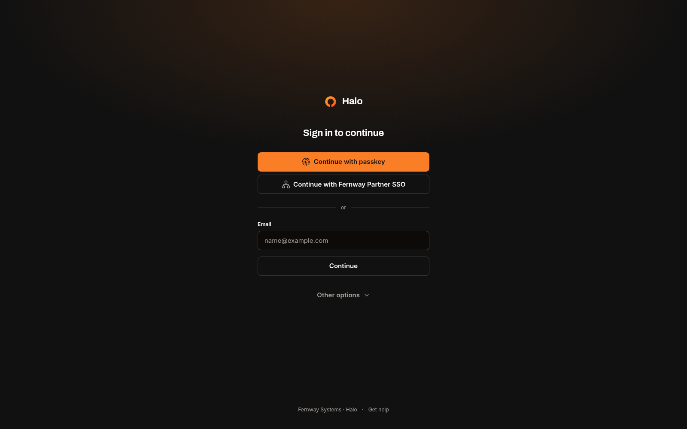
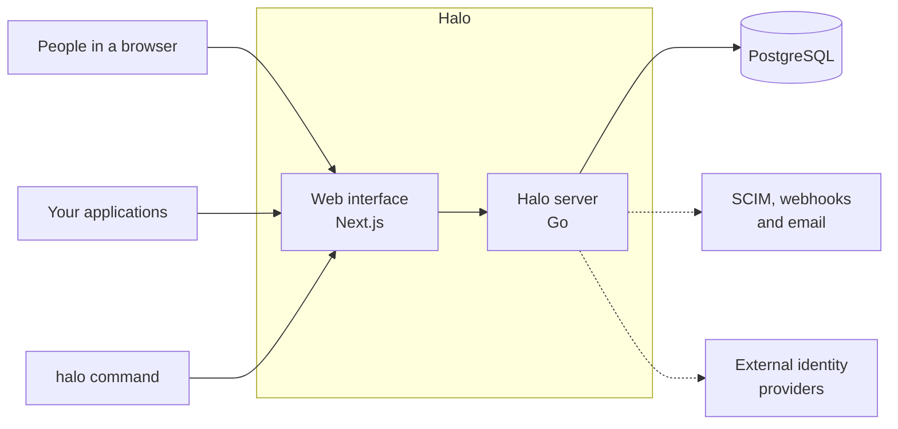

<h1></h1>

[](https://github.com/ScalaStudios/Halo/actions/workflows/ci.yml)
[](CHANGELOG.md)
[](LICENSE)

**Halo is an open-source identity and access management (IAM) platform that you host yourself.** It is where your organization decides who can sign in to which applications, how they prove who they are, and how long their access lasts.

In identity terms, Halo is an identity provider (IdP) for single sign-on (SSO) over OpenID Connect (OIDC) and SAML 2.0, with passwordless sign-in through passkeys, SCIM 2.0 provisioning, conditional access policies and identity governance. It comes with its own directory, admin console and account portal: it is not an authentication library or a proxy in front of your applications.

[Website](https://halo.scala.gg) · [Quick start](#quick-start) · [Documentation](https://halo.scala.gg/docs) · [Integrations](#connect-your-first-application) · [Security](SECURITY.md)

> [!NOTE]
> Halo is pre-release. The current release is 0.1.1, which the install script installs, and the API and configuration may change before 1.0. [CHANGELOG.md](CHANGELOG.md) lists what is included.


## Why Halo

Halo works in the same space as hosted services such as Microsoft Entra ID, Okta and Auth0, and open-source projects such as Keycloak, authentik and ZITADEL. It is built around a few choices:

- **No passwords by default.** People sign in with passkeys and security keys, which are phishing-resistant. Authenticator apps, recovery codes and emailed sign-in links are fallbacks that you can turn off. Passwords stay off until you turn them on, for example for the groups you are moving from another identity provider.
- **Access that ends.** Access packages with approvers and time limits, access reviews, and joiner, mover, leaver, date and inactivity rules are part of the core product.
- **Policies you can test before they apply.** Report-only mode shows what a policy would have done to the last 24 hours of sign-ins, and the simulator shows how your policies would treat a given sign-in.
- **Small to run.** A Go server, a Next.js web interface and PostgreSQL. No Redis, no message queue and no license key.
- **Open source.** Every feature is in this repository, licensed under Apache-2.0, and users, groups, applications and policies export as JSON.

## Features

| Area | What Halo includes |
| --- | --- |
| **Sign-in** | Passkeys and security keys (WebAuthn), authenticator apps (TOTP), single-use recovery codes, and magic links or one-time codes by email. Sign-in through Google, Microsoft Entra ID, GitHub or any OpenID Connect provider, with account linking and accounts created on first sign-in. |
| **Single sign-on** | An OpenID Connect provider and OAuth 2.0 authorization server for web, single-page, native and machine-to-machine applications. A SAML 2.0 identity provider with service provider metadata import and IdP-initiated sign-in. Forward auth for Traefik, nginx and Caddy in front of applications that support neither. |
| **Directory** | People with profiles and managers, assigned groups with owners and self-service joining, rule-based groups such as `user.department == "Engineering"`, service accounts, devices, and six administrative roles. |
| **Provisioning** | A SCIM 2.0 server, tested with the request formats of Okta and Microsoft Entra ID, so either of them or an HR system can provision people into Halo; and outbound SCIM that creates, updates and deactivates accounts in your applications and keeps the groups you choose in step. |
| **Access policies** | Conditional access by person, group, application, network zone, device trust, device compliance from Microsoft Intune or a device agent, sign-in risk and sign-in method, with effects that allow, block, require a passkey or security key, or require accepting versioned terms of use, report-only mode and a simulator. |
| **Governance** | Access packages that people request, with approvers, justifications and time limits; access reviews that can remove access automatically when they complete; administrator roles that eligible people activate for a few hours with a reason; guest accounts with a sponsor and an end date; and joiner, mover and leaver rules, plus rules that run on a date such as a contract end date or after a number of days without signing in. |
| **Infrastructure access** | An SSH certificate authority that issues short-lived certificates to people in mapped groups, through `halo login` and `halo ssh-cert`. |
| **Monitoring** | A sign-in log, an audit log of every administrative change, risk events for risky networks, repeated failures, new devices and new networks, signed webhooks for audit and sign-in events, and streaming of both to syslog or OpenTelemetry. |
| **Administration** | An admin console whose home page shows the directory, your roles, open risk events and shortcuts, a self-service account portal with profile pictures, organization branding, sign-in methods you can switch off, email over SMTP with retries, JSON export with scheduled exports to an S3-compatible bucket, import of configuration from an export with a dry run, and rotation of client secrets, signing keys and `HALO_SECRET_KEY`. |
| **Developers** | A REST API described by an OpenAPI 3.1 document, API keys for service accounts, API resources with their own scopes and JWT access tokens, and setup guides with ready-made configuration for common applications. |

Not built yet: LDAP directory sync. See the [roadmap](#roadmap).

## Supported standards

| Standard | Status | How Halo uses it |
| --- | --- | --- |
| OpenID Connect Core 1.0 and Discovery 1.0 | Implemented | ID tokens signed with RS256, ES256 or EdDSA, userinfo, `prompt` and `max_age`, discovery at `/.well-known/openid-configuration`, RP-initiated logout, and back-channel logout with signed logout tokens |
| OAuth 2.0 (RFC 6749) | Implemented | Authorization code, refresh token and client credentials grants; refresh tokens rotate by default, and a used one is rejected |
| PKCE (RFC 7636) | Implemented | `S256`, required for single-page and native applications |
| Device Authorization Grant (RFC 8628) | Implemented | Used by `halo login` to sign people in on the command line |
| Token Introspection (RFC 7662) and Revocation (RFC 7009) | Implemented | Introspection for APIs that check opaque tokens, and revocation for applications that sign people out |
| Resource Indicators (RFC 8707) | Partial | The `resource` parameter selects an API resource on authorization, device, client credentials and token exchange requests, and its JWT access tokens carry it in `aud` |
| Token Exchange (RFC 8693) | Partial | Web and service applications with token exchange turned on trade a person's access token for one to an API they have scopes on, with the application in the `act` claim. Access tokens only, and no `actor_token` |
| SAML 2.0 | Implemented | Web browser single sign-on as an identity provider: SP- and IdP-initiated, HTTP-Redirect and HTTP-POST bindings, signed assertions and metadata, and assertions encrypted with AES-256-GCM or AES-256-CBC per service provider. No single logout |
| SCIM 2.0 (RFC 7643 and RFC 7644) | Implemented | A server for users and groups with the full filter grammar and bulk operations, and a client that provisions users into applications |
| WebAuthn and FIDO2 | Implemented | Passkeys and security keys as discoverable credentials, for sign-in without a username |
| TOTP (RFC 6238) | Implemented | Six-digit codes from authenticator apps |
| LDAP | Not implemented | Planned |

"Implemented" means the feature works in the current release. Halo has not been through OpenID Foundation conformance testing or any other certification.

## Quick start

### Install on a server

You need a Linux server with `curl` and `openssl`, a domain name such as `auth.example.com` that points at the server, and ports 80 and 443 open to the internet. Run the script as root and it installs Docker if the server doesn't have it.

```bash
curl -fsSL https://halo.scala.gg/install.sh | sh
```

The script asks for your domain and organization name, sets Halo up in `/opt/halo` (or `~/halo` when you are not root), generates a database password and `HALO_SECRET_KEY`, then downloads and starts PostgreSQL, Halo and Caddy, which obtains a TLS certificate for your domain. [Read the script](deploy/install.sh) before you run it if you prefer.

When it finishes, create the first administrator with the command it prints:

```bash
/opt/halo/halo.sh admin you@example.com "Your Name"
```

Open the link it prints and register a passkey. The console is at `https://auth.example.com/admin`. To install step by step instead, and for backups, upgrades and email, follow the [self-hosting guide](https://halo.scala.gg/docs/self-hosting).

### Run from source

To work on Halo or try it on your own computer, you need Go 1.27, [Bun](https://bun.sh) 1.3 or Node.js 22, and Docker.

```bash
git clone https://github.com/ScalaStudios/Halo.git && cd Halo
docker compose -f compose.dev.yml up -d
cp .env.example .env
```

Set `HALO_SECRET_KEY` in `.env` to the output of `openssl rand -base64 32`. Then create an administrator and start the server:

```bash
set -a && . ./.env && set +a
go run ./cmd/halo bootstrap --email you@example.com --name "Your Name"
go run ./cmd/halo serve
```

Start the web interface in a second terminal:

```bash
cd web && bun install && bun run dev
```

Open the setup link that `bootstrap` printed to register your passkey. Halo runs at http://localhost:3200. To explore a populated organization instead, `go run ./cmd/halo seed-demo` loads Fernway Systems, a demo company with 68 people; [Get started](https://halo.scala.gg/docs/getting-started#explore-with-demo-data) explains how to sign in to it.

## Connect your first application

1. In the console, open **Applications**, choose **Add application**, then **OpenID Connect** and **Web application**. Pick a template such as **Grafana**, or **Custom**.
2. Enter the application's redirect URI and choose **Create application**. Copy the client ID and the client secret; Halo shows the secret only once.
3. Open the application, go to **Users & groups**, and assign the groups whose members may sign in. Until a group is assigned, nobody can.
4. Configure the application with Halo's issuer, such as `https://auth.example.com`. Applications that support discovery read every endpoint from `https://auth.example.com/.well-known/openid-configuration`.

Each application page in the console shows its connection details and a setup guide with your values filled in. For Grafana, the guide is a block for `grafana.ini`:

```ini
[auth.generic_oauth]
enabled = true
name = Halo
allow_sign_up = true
client_id = hl_…
client_secret = $__file{/etc/grafana/halo-client-secret}
scopes = openid profile email groups
auth_url = https://auth.example.com/oauth2/authorize
token_url = https://auth.example.com/oauth2/token
api_url = https://auth.example.com/oauth2/userinfo
use_pkce = true
groups_attribute_path = groups
role_attribute_path = contains(groups[*], 'Grafana editors') && 'Editor' || 'Viewer'
```

Step-by-step guides cover [Grafana](https://halo.scala.gg/docs/integrations/grafana), [Forgejo](https://halo.scala.gg/docs/integrations/forgejo), [Nextcloud](https://halo.scala.gg/docs/integrations/nextcloud), [Kubernetes with kubelogin](https://halo.scala.gg/docs/integrations/kubernetes), [Proxmox VE](https://halo.scala.gg/docs/integrations/proxmox), [Outline](https://halo.scala.gg/docs/integrations/outline) and [Headscale](https://halo.scala.gg/docs/integrations/headscale) over OpenID Connect, and [AWS IAM Identity Center](https://halo.scala.gg/docs/integrations/aws-iam-identity-center) and [Slack](https://halo.scala.gg/docs/integrations/slack) over SAML. For anything else that supports OpenID Connect or SAML 2.0, start from the [generic OpenID Connect](https://halo.scala.gg/docs/integrations/generic-oidc) or [generic SAML](https://halo.scala.gg/docs/integrations/generic-saml) guide. [`examples/`](examples) has small Go applications that sign in with Halo over each protocol.

To automate Halo itself, create a service account with the user administrator role and an API key, and call the API. This invites a person and returns their setup link:

```bash
curl -X POST https://auth.example.com/api/v1/users \
  -H "Authorization: Bearer $HALO_API_KEY" \
  -H "Content-Type: application/json" \
  -d '{"email": "sam@example.com", "name": "Sam Lee", "department": "Engineering"}'
```

Every route is described in the OpenAPI document at `/api/v1/openapi.yaml`; the [API guide](https://halo.scala.gg/docs/api) covers authentication, roles and errors.

### Applications without OpenID Connect or SAML

Forward auth puts Halo's sign-in in front of applications that have their own login or none, such as admin consoles, file servers and internal tools. The reverse proxy in front of the application asks Halo before every request, and keeps carrying the traffic itself.

1. Choose **Add application**, then **Forward auth**, and enter the address people open the application at, such as `https://files.example.com`. Add more hosts on the **Authentication** tab.
2. Assign groups on **Users & groups**.
3. Copy the Traefik, nginx or Caddy configuration from the application's **Overview** tab. For Caddy:

```caddy
https://files.example.com {
	forward_auth https://auth.example.com {
		uri /forward-auth/app_…/verify
		header_up Host {upstream_hostport}
		copy_headers X-Halo-User X-Halo-Email X-Halo-Name X-Halo-Groups
	}
	reverse_proxy 127.0.0.1:8080
}
```

- People who are signed in and assigned get through, and the application receives `X-Halo-User` (the person's id), `X-Halo-Email`, `X-Halo-Name` and `X-Halo-Groups` (group names separated by commas, with a comma inside a name sent as a space), and `X-Halo-Roles` when the application has roles. Change the names, or add custom attributes, on the **Headers** tab. The proxy replaces any copy of these headers that the browser sends, so make the application reachable only through the proxy.
- Everyone else goes to Halo's sign-in page. Halo checks the group assignment, the sign-in frequency and the access policies, writes the sign-in log, and only sends people back to the application's own addresses.
- Halo never gives its session cookie to the application. After sign-in it sets a separate cookie on each protected host through `/_halo/callback`, with a code that works once and only in the browser that started the sign-in. The cookie lasts as long as the Halo session: signing out, revoking the session, the session limit, suspending the person or removing their access ends it on the next request, and Halo checks the access policies again at least every hour.
- `/_halo/sign-out` on the application's address signs the person out of the application and of Halo.
- Halo reads `X-Forwarded-Host` and `X-Forwarded-Uri` only from addresses in `HALO_TRUSTED_PROXIES`. The web interface replaces `X-Forwarded-Host` with Halo's own host, so through Halo's public address only applications with one protected address work. For more than one, point the proxy at the Halo server directly, such as `http://halo-server:8080` in the Compose setup, and add the proxy's address to `HALO_TRUSTED_PROXIES`.

## Screenshots

<table>
  <tr>
    <td width="50%"><br>Passkey-first sign-in</td>
    <td width="50%"><br>Connection details and a setup guide for every application</td>
  </tr>
  <tr>
    <td width="50%"><br>Conditional access with report-only insights</td>
    <td width="50%"><br>Access reviews with automatic removal</td>
  </tr>
</table>

## Architecture



The web interface is the only public entry point. It serves the console, the account portal and the sign-in pages, and forwards API and protocol paths to the Go server, so cookies, the OpenID Connect issuer and the passkey domain share one address. The Go server holds the logic, runs background jobs such as email delivery and outbound SCIM, and stores everything in PostgreSQL.

| Path | What it serves |
| --- | --- |
| `/admin`, `/account`, `/sign-in` | The console, the account portal and the sign-in pages |
| `/api/v1/*` | The management and account API, described at `/api/v1/openapi.yaml` |
| `/oauth2/*`, `/.well-known/openid-configuration` | The OpenID Connect provider |
| `/saml/*` | The SAML 2.0 identity provider |
| `/forward-auth/*` | The check reverse proxies run before each request to a forward-auth application, and its sign-in |
| `/scim/v2/*` | The SCIM 2.0 server |

[Architecture](https://halo.scala.gg/docs/architecture) covers the Go packages and how a sign-in flows through them.

## Self-hosting

Self-hosted Halo runs on your own infrastructure and needs no external service. A production installation is four containers: PostgreSQL 17, the Halo server, the web interface, and Caddy for TLS. The [self-hosting guide](https://halo.scala.gg/docs/self-hosting) walks through it step by step.

- **Requirements.** A Linux host with Docker Engine and the Compose plugin, which the install script installs when you run it as root, a domain name, and ports 80 and 443 reachable from the internet. Images are published for `linux/amd64` and `linux/arm64`. On a test machine, the four running containers used about 200 MB of memory at idle.
- **Choose a domain you will keep.** Halo's address is the OpenID Connect issuer that every application stores, and passkeys only work on the domain they were created for.
- **Back up two things.** The database, and `HALO_SECRET_KEY`, which encrypts signing keys and other stored secrets. A backup cannot be restored without the key that was in use when it was taken.
- **Run one Halo server.** Some background jobs, such as outbound SCIM, access expiry and lifecycle rules, run in every server process without coordinating with other processes.
- **Email is optional.** Without an SMTP server, administrators pass invite and reset links on themselves. With one, Halo emails them, and people can sign in with magic links.
- **Kubernetes.** A Helm chart in [`deploy/helm/halo`](deploy/helm/halo) deploys the server and the web interface, with an optional PostgreSQL, and reads `HALO_SECRET_KEY` and the database URL from an existing Secret. [Its README](deploy/helm/halo/README.md) covers installation and upgrades.

### Metrics

The server can expose Prometheus metrics at `/metrics`. They are off until you set one of these:

- `HALO_METRICS_LISTEN`, such as `:9090`, serves `/metrics` on that address only. Keep the port off the internet.
- `HALO_METRICS_TOKEN` requires `Authorization: Bearer <token>`. On its own it serves `/metrics` on `HALO_LISTEN`; with `HALO_METRICS_LISTEN` it protects that address too. Generate one with `openssl rand -hex 32`.

Labels never hold people, email addresses, IP addresses or client IDs, and HTTP routes are the route pattern, such as `GET /api/v1/users/{id}`, not the requested path.

| Series | Labels |
| --- | --- |
| `halo_sign_in_events_total` | `method`, `result` (`success`, `failure`, `interrupted`, `ended`), `risk` |
| `halo_lockouts_total` | `scope`: `account`, or `address` for too many failed passwords from one IP address |
| `halo_tokens_issued_total` | `grant`: `authorization_code`, `refresh_token`, `device_code`, `client_credentials`, `token_exchange`, `workload_identity` |
| `halo_refresh_tokens_refused_total` | |
| `halo_scim_outbound_runs_total` | `result`: `success`, `failure` |
| `halo_scim_outbound_records_total` | `resource`: `user`, `group`; `action`: `created`, `updated`, `deactivated`, `deleted` |
| `halo_webhook_deliveries_total` | `outcome`: `delivered`, `pending` (retried later), `failed` (out of retries) |
| `halo_log_export_events_total` | `outcome`: `sent`, `failed` (retried later), `rejected` (refused by the collector), `dropped` (queue full) |
| `halo_rate_limited_requests_total` | `scope`: `api`, `scim`, `bulk` |
| `halo_http_requests_total`, `halo_http_request_duration_seconds` | `route`, plus `status` on the counter |
| `halo_db_pool_acquired_connections`, `_idle_`, `_total_`, `_max_connections` | |
| `go_goroutines`, `go_memstats_heap_alloc_bytes`, `go_memstats_sys_bytes`, `go_gc_cycles_completed` | |

Example alert rules:

```yaml
groups:
  - name: halo
    rules:
      - alert: HaloFailedSignInSpike
        expr: sum(increase(halo_sign_in_events_total{result="failure"}[10m])) > 50
      - alert: HaloSCIMFailing
        expr: sum(increase(halo_scim_outbound_runs_total{result="failure"}[1h])) > 0 unless sum(increase(halo_scim_outbound_runs_total{result="success"}[1h])) > 0
      - alert: HaloWebhookGaveUp
        expr: sum(increase(halo_webhook_deliveries_total{outcome="failed"}[15m])) > 0
      - alert: HaloLogExportFailing
        expr: sum(increase(halo_log_export_events_total{outcome=~"failed|rejected|dropped"}[15m])) > 0
      - alert: HaloLockouts
        expr: sum(increase(halo_lockouts_total[15m])) > 10
```

### Log streaming

Halo can stream every sign-in event and audit event, with the audit event's changes, to a log collector or SIEM. Set it up under Monitoring, Log streaming, or with environment variables, which then take precedence and make the console read-only:

- `HALO_LOG_EXPORT_PROTOCOL`: `syslog-tls` for RFC 5424 over TCP with TLS, `syslog-udp` for lab use, or `otlp-http` for an OpenTelemetry collector over OTLP/HTTP with JSON.
- `HALO_LOG_EXPORT_ENDPOINT`: `host:port` for syslog, such as `siem.example.com:6514`, or the collector URL, such as `https://otel.example.com:4318/v1/logs`.
- `HALO_LOG_EXPORT_HEADERS`: OTLP headers as `name=value` pairs separated by commas, such as `Authorization=Bearer <token>`. Halo stores them encrypted and never shows them again.
- `HALO_LOG_EXPORT_ALLOW_PRIVATE=1`: send to private, loopback and link-local addresses, and allow `http://` for OTLP. Without it Halo only connects to public addresses.

Each event is the same JSON as a webhook's, in the syslog message or the OTLP log record body, with secret values already redacted from audit changes. Syslog messages use the `authpriv` facility, the `halo` app name and the event type as the message ID. Halo sends new events every 10 seconds, starting with those recorded after the exporter is first saved. When the collector is down, events wait in the database and Halo retries with a growing delay, up to 5 minutes, so sign-ins never wait for the collector. The console shows the last successful send and how many events are waiting. When more than 100,000 events of one kind are waiting, the oldest are dropped, and an outage longer than the log retention loses the events the retention deletes. To trust a private certificate authority for syslog over TLS, point `SSL_CERT_FILE` at a bundle that holds the system certificates and your authority, since it replaces the system bundle for every connection Halo makes.

## Halo Cloud

A hosted version of Halo is planned for teams that would rather not run it themselves. Follow [halo.scala.gg](https://halo.scala.gg) for news. Self-hosting is meant to stay complete, with no paid tier for core features and no dependency on proprietary infrastructure.

## Roadmap

Planned:

- Halo Cloud, the hosted version
- LDAP directory sync

Known limitations today:

- One organization per installation.
- Run a single Halo server; see [Self-hosting](#self-hosting).
- Halo has not been through OpenID Connect conformance testing or an independent security audit.

[CHANGELOG.md](CHANGELOG.md) records what has shipped.

## Documentation

The documentation lives at [halo.scala.gg/docs](https://halo.scala.gg/docs).

- [Get started](https://halo.scala.gg/docs/getting-started): run Halo locally and sign in to an example application through it.
- [Concepts](https://halo.scala.gg/docs/concepts): users, groups, roles, applications, sessions and sign-in methods.
- [Configuration](https://halo.scala.gg/docs/configuration): every environment variable and console setting.
- [Access policies](https://halo.scala.gg/docs/policies) and [governance](https://halo.scala.gg/docs/governance): who gets in, under which conditions, and for how long.
- [Federation](https://halo.scala.gg/docs/federation): sign-in with Google, Microsoft Entra ID, GitHub or another OpenID Connect provider.
- [Provisioning](https://halo.scala.gg/docs/provisioning): SCIM in both directions, service accounts and API keys.
- [Webhooks](https://halo.scala.gg/docs/webhooks) and the [API](https://halo.scala.gg/docs/api): automate Halo and react to its events.
- [Infrastructure access](https://halo.scala.gg/docs/infrastructure-access): SSH certificates with `halo login` and `halo ssh-cert`.
- [Security model](https://halo.scala.gg/docs/security-model): how Halo protects sessions, secrets and tokens, and its known limitations.

## Contributing

Bug reports, fixes, documentation and features are welcome. Report bugs and propose features in [GitHub issues](https://github.com/ScalaStudios/Halo/issues), and open an issue before starting anything large, such as a new feature, a new dependency or a schema change. [CONTRIBUTING.md](CONTRIBUTING.md) covers the development setup, the checks CI runs and the code style, and [Architecture](https://halo.scala.gg/docs/architecture) maps the code. Everyone taking part follows the [Code of Conduct](CODE_OF_CONDUCT.md).

## Security

Report vulnerabilities privately through [GitHub's private vulnerability reporting](https://github.com/ScalaStudios/Halo/security/advisories/new), never in a public issue. [SECURITY.md](SECURITY.md) lists what to include and the response times to expect.

Halo stores session tokens, client secrets, API keys and refresh tokens only as SHA-256 hashes, encrypts signing keys and other stored secrets with AES-256-GCM, writes every administrative change to the audit log in the same transaction, and refuses to start without HTTPS outside development. The [security model](https://halo.scala.gg/docs/security-model) explains each of these and lists the known limitations.

## License

Halo is licensed under the [Apache License 2.0](LICENSE). Two React Bits components in `web/src/components/reactbits/` keep their own MIT + Commons Clause terms; [NOTICE](NOTICE) has the details.

Halo is a Scala Studios project.
